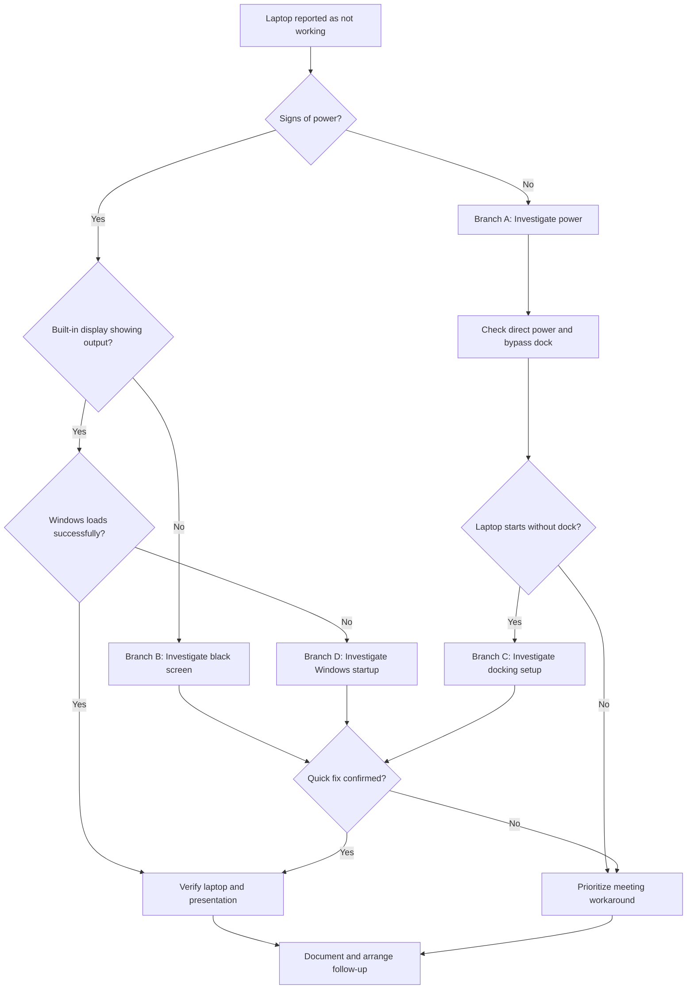

# Case 01: Time Critical Incident | Laptop Startup Failure

**Endpoint Support | Hardware Triage | Business Continuity**

*Simulated Case Study | Based on my professional IT support approach*

> This case demonstrates how I would investigate a time-critical endpoint issue, drawing on my previous IT support experience. The diagnostic paths are hypothetical and do not represent tests performed on an actual device.

---

## 1. Incident Overview

| Category | Assessment |
|---|---|
| **Incident** | Laptop fails to start |
| **Business Impact** | Important presentation in 15 minutes |
| **Immediate Objective** | Enable the user to attend and present |
| **Technical Investigation** | Power delivery, display, docking station, startup diagnostics |

**My initial decision:** Limit hardware diagnostics to a few minutes while investigating access to the presentation and the availability of an approved alternative device.

**Reasoning:** The cause is still unknown. A quick fix may be possible, but repairing the laptop could also require extensive investigation. I want to preserve enough time to arrange a workaround before the meeting starts.

---

## 2. Initial Assessment

### The Situation

A user contacts the Service Desk:

> "My laptop isn't working, and I have an important meeting in 15 minutes. I need to present a PowerPoint file."

### Initial Response

"I understand this is frustrating, especially with your meeting starting in 15 minutes. Let's see how we can get you into that meeting."

### Establishing the Facts

Before deciding where to begin troubleshooting, I need to understand what the user is actually experiencing and what is required for the meeting.

| Assessment Area | My Questions | What I Want to Establish |
|---|---|---|
| **Business Requirements** | What do you need to participate in the meeting? | The immediate business objective |
| **Incident Symptoms** | What happens when you try to start your laptop? | What "not working" actually means |
| **Power Indicators** | Do you see any lights or hear any sounds? | Whether the laptop shows signs of power |
| **Device Configuration** | Is the laptop connected to a docking station? | Possible external points of failure |
| **Presentation Availability** | Is your presentation stored in SharePoint, OneDrive, or somewhere else? | Whether the file can be accessed independently of the laptop |
| **Alternative Hardware** | Is a spare or presentation laptop available? | Whether an approved alternative device could be used |

### My Assessment

At this point, I cannot determine whether the problem is a simple connection issue or a more serious hardware failure.

Two activities therefore need to run in parallel:

1. **Technical investigation:** Identify whether a quick fix is possible.
2. **Business continuity:** Establish how the user could attend and present if the laptop remains unavailable.

My priority is to avoid spending the entire fifteen minutes investigating a fault while a workable alternative may be available.

---

## 3. Diagnostic Investigation & Decision Tree

### My Investigation Strategy

I begin by distinguishing between three possible problem areas:

- **Power:** Is the laptop receiving power?
- **Display:** Is the laptop running without producing a visible image?
- **Startup:** Does the laptop power on but fail to load Windows?

The symptoms determine which investigation path I follow.

I would time-box the initial checks to a few minutes. If they do not lead to a quick solution, I shift my immediate attention to the meeting workaround and continue the technical investigation afterward.

### Diagnostic Decision Tree

### Parallel Priority

Throughout the investigation, I assess whether the user can access the presentation through:

- **SharePoint or OneDrive**, if the file is stored there.
- Another authorized storage location.
- An approved spare or presentation laptop.
- Another managed workstation or an authorized colleague.

**Decision point:** If initial diagnostics do not restore functionality within a few minutes, I prioritize the meeting workaround rather than continue troubleshooting at the expense of the deadline.

---

## 4. Technical Troubleshooting Branches

Each branch represents a possible investigation path based on the symptoms identified during the initial assessment.

The objective is to narrow down the cause through observations and controlled checks, without treating an assumption as a confirmed diagnosis.

<strong>Branch A: No Signs of Power</strong>

### My First Question

**Is the laptop receiving power?**

If there are no visible indicators or signs of activity, I begin with the external power supply before assuming an internal hardware failure.

### Investigation

1. Check whether any power indicators or charging LEDs are visible.
2. Verify that the power adapter and cable are connected securely.
3. Establish whether the power outlet is functioning.
4. Ask whether the laptop is connected to a docking station.
5. Disconnect the dock and unnecessary peripherals.
6. Connect the appropriate power adapter directly to the laptop.
7. Observe whether the charging indicator or startup behavior changes.

### Interpreting the Findings

| What I Observe | What I Consider | My Next Step |
|---|---|---|
| Laptop starts with direct power | Docking setup or power delivery may be involved | Investigate Branch C |
| No charging indicator with direct power | Adapter, charging port, battery, or internal power issue | Arrange further hardware diagnostics |
| Charging LED appears, but no startup | Power may be reaching the device, but startup is failing | Investigate startup symptoms and hardware indicators |

### My Decision

If the laptop responds when connected directly to power, I have narrowed down the possibilities. However, this does not yet confirm which component is responsible.

If these checks do not produce a quick solution, I prioritize the user's meeting and arrange further hardware investigation afterward.

<strong>Branch B: Power Present, Black Screen</strong>

### My First Question

**Is the laptop running without displaying an image, or is startup itself failing?**

Power indicators and a black screen do not necessarily indicate the same underlying fault.

### Investigation

1. Confirm which lights, sounds, or signs of activity are present.
2. Check whether anything appears on the built-in display.
3. Disconnect the docking station and external monitors.
4. Check the display brightness and response.
5. Observe whether a manufacturer logo or startup message appears.
6. Record any unusual indicator patterns or error messages.

### Interpreting the Findings

| What I Observe | What I Consider | My Next Step |
|---|---|---|
| Built-in display works without the dock | External display or docking issue | Continue with Branch C |
| Power indicators active, no image | Display, graphics, firmware, or internal hardware issue | Continue approved model-specific diagnostics |
| Manufacturer logo appears, Windows fails to load | Operating system or boot issue | Continue with Branch D |
| Windows loads successfully | Startup is functioning | Verify meeting requirements |

### My Decision

I do not conclude that the laptop is defective simply because the screen remains black.

The next investigation depends on how far the device progresses through startup.

If the cause is not quickly identified, I return to the immediate business requirement rather than continue an uncertain diagnosis under time pressure.

<strong>Branch C: Docking Station or External Display Issue</strong>

### My First Question

**Does the laptop function independently of its docking station?**

Docking stations add connections, cables, power delivery, and external devices. I want to isolate these components before concluding that the laptop itself is failing.

### Investigation

1. Disconnect the laptop from the docking station.
2. Check whether it operates using the built-in display.
3. Connect the appropriate power adapter directly if necessary.
4. Observe whether the startup behavior changes.
5. If the laptop functions independently, examine the dock's power supply and connections.
6. Investigate external monitors, cables, inputs, and display settings where relevant.

### Interpreting the Findings

| What I Observe | What I Consider | My Next Step |
|---|---|---|
| Laptop works without the dock | Dock or peripheral fault may be involved | Isolate connected components |
| Laptop charges directly but not through dock | Dock power delivery or compatibility issue | Check power and configuration |
| Laptop works, external monitor remains black | Monitor, cable, input, or display configuration | Investigate external display |
| Laptop still fails without the dock | Problem may originate elsewhere | Return to the appropriate power or startup branch |

### My Decision

If the laptop works independently of the docking station, I would first determine whether the user can participate in the meeting without the dock.

There is no reason to delay the meeting to investigate a peripheral problem if the laptop itself can support the user's immediate needs.

The docking station investigation can continue separately.

<strong>Branch D: Windows Startup Failure</strong>

### My First Question

**How far does the laptop progress through startup?**

If the manufacturer logo appears but Windows does not load, the investigation moves beyond the initial power checks.

### Investigation

1. Determine whether the manufacturer logo appears.
2. Observe whether Windows begins loading.
3. Record error messages, stop codes, or recovery screens.
4. Ask when the laptop last started successfully.
5. Check whether recent updates, configuration changes, or unexpected shutdowns preceded the problem.
6. Establish whether the behavior is consistent or intermittent.

### Interpreting the Findings

| What I Observe | What I Consider | My Next Step |
|---|---|---|
| Manufacturer logo appears, Windows does not load | Boot, storage, or operating system problem | Investigate startup symptoms |
| Windows recovery screen appears | Detected startup failure | Follow approved recovery procedures |
| Stop code appears | Possible driver, software, or hardware issue | Record and investigate the exact code |
| Windows starts after retrying | Possible intermittent issue | Verify functionality and document observations |

### My Decision

I would not begin lengthy or potentially disruptive recovery procedures while the meeting deadline is approaching.

Further diagnostics and recovery should follow organizational procedures, including requirements for data protection, encryption, and recovery access.

The immediate priority remains getting the user into the meeting.

### My Diagnostic Reasoning

My investigation is driven by what I observe, not by assumptions about what might be broken.

Each check should help narrow down the possible causes and determine the next action.

The time constraint also influences my decisions. A technically valid investigation is not necessarily the best immediate use of the remaining time.

---

## 5. Business Continuity & Workaround Assessment

### My Immediate Question

**Can the user deliver the presentation without relying on the affected laptop?**

I investigate the presentation's location and the available hardware alongside the initial troubleshooting.

### Presentation Availability

| Where the File Is Stored | My Consideration | My Next Action |
|---|---|---|
| **SharePoint / OneDrive** | The presentation may be accessible independently of the laptop | Check access from an approved device |
| **Departmental Shared Storage** | An authorized workstation may provide access | Check availability and permissions |
| **Local Laptop Storage** | The file may be unavailable if the device cannot start | Check for copies, backups, or earlier shared versions |
| **Shared with Colleagues** | Another authorized person may have the presentation | Verify access to the correct version |

### Alternative Hardware

I would check what is available within the organization:

- A designated presentation laptop.
- An approved spare or replacement device.
- Another managed workstation.
- An authorized colleague's assistance with presenting.
- An approved mobile device, if suitable for the meeting.

My choice depends on availability, access permissions, security requirements, and what the user needs to accomplish.

### Verifying the Workaround

Before considering the immediate business need addressed, I want to establish:

| My Check | What I Need to Confirm |
|---|---|
| **Meeting Access** | The user can join the meeting |
| **Presentation Access** | The correct file is available |
| **Presentation Functionality** | The user or authorized colleague can present |
| **Business Requirement** | The alternative supports the essential meeting activities |

### My Decision

If an approved alternative enables the user to attend and present, I would prioritize getting that solution working reliably.

The laptop incident remains unresolved until the underlying problem has been investigated and an appropriate outcome established.

**My reasoning:** Restoring the user's ability to work and repairing the original device are two separate objectives. They may require different actions and different timelines.

---

## 6. Incident Ownership & Follow-Up

Once the immediate meeting requirement has been addressed, or the available alternatives have been exhausted, I would ensure that the technical incident receives appropriate follow-up.

### What I Document

| Documentation Area | Information I Record |
|---|---|
| **Reported Issue** | Original symptoms and the user's description |
| **Business Impact** | Meeting deadline and affected activities |
| **Technical Observations** | Power, display, docking station, and startup behavior |
| **Investigation** | Actions performed and the results observed |
| **Workaround** | Alternatives considered, attempted, and verified |
| **Outstanding Issues** | Unresolved symptoms and possible causes |
| **Next Actions** | Ownership, escalation, and follow-up arrangements |

I want the ticket to contain enough information for another technician to continue the investigation without asking the user to repeat everything.

### Further Technical Investigation

The next actions would depend on the evidence already collected. They might involve:

- Power adapter and charging system testing.
- Docking station and peripheral diagnostics.
- Manufacturer-specific hardware testing.
- Windows startup and recovery investigation.
- Specialist escalation or device replacement.

### Resolution and Verification

I distinguish between two outcomes:

| Outcome | My Verification |
|---|---|
| **Business functionality restored** | The user can attend and deliver the presentation |
| **Technical incident resolved** | The original laptop fault has been addressed and functionality verified |

If a workaround restores the immediate business function but the laptop remains faulty, I document that distinction and ensure the remaining issue is tracked according to the organization's procedures.

---

## 7. Professional Reasoning & Key Decisions

| My Decision | Reasoning |
|---|---|
| Clarify the meeting requirements first | I need to understand the business objective before assuming a technical solution |
| Establish the actual symptoms | "Not working" does not identify the cause |
| Check power and docking connections | A simple external fault may be isolated quickly |
| Distinguish power, display, and startup failures | Each symptom leads to a different diagnostic path |
| Time-box initial troubleshooting | Preserve time for an alternative before the meeting starts |
| Check SharePoint, OneDrive, and shared storage | The presentation may be accessible without the affected laptop |
| Investigate approved alternative devices | Business functionality may be restored before hardware repair |
| Document and follow up | A workaround does not eliminate the underlying fault |

### My Approach

The central decision in this case is how to use the available time effectively.

I want to investigate the laptop, but I also recognize that a complete repair cannot be guaranteed within fifteen minutes.

By clarifying the user's immediate requirements, limiting the initial diagnostics, and investigating alternatives in parallel, I can make informed decisions without losing sight of the business impact.

**My objective is to help the user continue working while maintaining ownership of the unresolved technical problem.**

---

## 8. Case Study Scope

This is a simulated incident based on my professional IT support approach.

The diagnostic branches describe how I would investigate possible symptoms and make decisions based on the findings. They do not represent completed tests, confirmed faults, or actual incident outcomes.

Procedures, escalation paths, access permissions, and incident priorities would be aligned with the organization's operating environment and policies.
